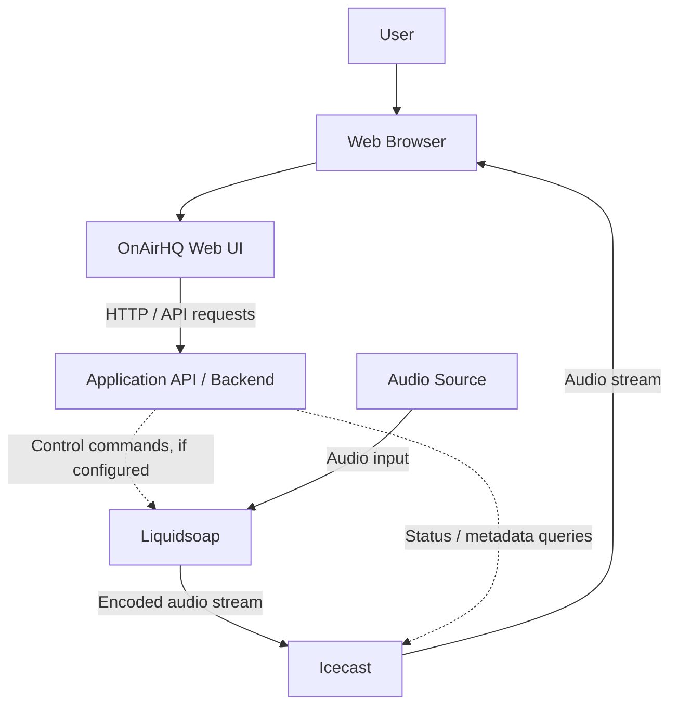

# OnAirHQ 

A self-hosted environment for understanding, running, and exploring the OnAirHQ ecosystem.

# Architecture

The following diagram illustrates a typical integration between these components. The exact control paths depend on the OnAirHQ implementation.

