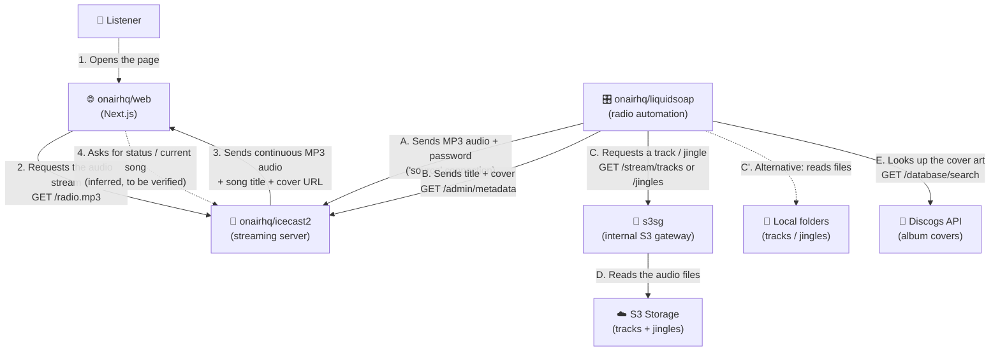

# OnAirHQ 

A self-hosted environment for understanding, running, and exploring the OnAirHQ ecosystem.

# Architecture

## Who talks to whom (short version)

| From | To | In plain words |
|---|---|---|
| Browser (Web Player) | Icecast | The browser asks for the radio and receives continuous sound |
| Liquidsoap | Icecast | Liquidsoap "broadcasts" the radio into Icecast |
| Liquidsoap | Icecast (metadata) | Liquidsoap announces which song is playing now |
| Liquidsoap | s3sg | Liquidsoap asks for the next track or jingle |
| s3sg | S3 | The gateway fetches the audio file from storage |
| Liquidsoap | Discogs | Liquidsoap looks up the album cover |

---

## 1. Web Player → Icecast (the listener)

**Request type:** `GET` (HTTP, connection stays open)
**Example address:** `http://localhost:8000/radio.mp3`

| Sends | Receives |
|---|---|
| A simple listen request (usually via an `<audio>` tag), no password | Continuous MP3 audio (128 kbps by default) |
| | Song title and cover URL, inside the stream metadata |

The listener sends no personal data and needs no account.

**Inferred, to be verified in `web/src`:** the player likely polls the server status (e.g. `/status-json.xsl`, a standard Icecast endpoint) to display the current song. The README does not confirm this.

---

## 2. Liquidsoap → Icecast (audio broadcast)

**Request type:** HTTP "source" connection that stays open permanently.
**Authentication:** user `source` + the `ICECAST_PASSWORD` password.

| Sends | Receives |
|---|---|
| MP3-encoded audio (bitrate 8–320 kbps, default 128) | Confirmation that it was accepted as a source |
| Radio name, genre, description, website URL | |

The password must be **identical** in Liquidsoap (`ICECAST_PASSWORD`) and in Icecast (`ICECAST_SOURCE_PASSWORD`). If they differ, Icecast rejects the connection.

---

## 3. Liquidsoap → Icecast ("now playing" update)

**Request type:** `GET` to Icecast's admin endpoint (`/admin/metadata`)
**Authentication:** same `source` user + password.

| Sends | Receives |
|---|---|
| `song` = "Artist - Title" | Simple confirmation (OK) |
| `url` = link to the album cover (from Discogs) | |
| For jingles: `song` = `--jingle--` and empty `url` | |

Metadata is sent separately from the audio so that players keep the cover link.

---

## 4. Liquidsoap → s3sg (internal gateway)

**Request type:** `GET`, only inside the container (`127.0.0.1:8090`)

| Address | What it requests |
|---|---|
| `/stream/tracks` | The next track |
| `/stream/jingles` | The next jingle |

| Sends | Receives |
|---|---|
| A simple request, no data | Audio (HTTP stream) |
| | Metadata: title and an `Icy-Radio-Jingle` flag (true/false) |

**Rotation logic:** Liquidsoap requests `JINGLE_EVERY` tracks (default 4), then one jingle. If the stream drops, it automatically requests the next one.

The gateway is reachable only from the inside (127.0.0.1). Only its activation through `S3_BUCKET` is confirmed in the README.

---

## 5. s3sg → S3 Storage

**Request type:** standard S3 requests (list and read objects). I could not verify the exact details because access to the `s3sg` code was blocked.

| Sends | Receives |
|---|---|
| Access keys (`S3_ACCESS_KEY_ID` + `S3_SECRET_ACCESS_KEY`) | Audio files from the `tracks/` and `jingles/` folders |
| Bucket name and region | |

Works with any S3-compatible storage (AWS, MinIO, Cloudflare R2) via `S3_ENDPOINT`.

**Without S3:** Liquidsoap reads directly from the local folders `/app/storage/tracks` and `/app/storage/jingles`. It automatically detects added or removed files, with no restart needed.

---

## 6. Liquidsoap → Discogs (optional)

**Request type:** `GET` to `https://api.discogs.com`. Enabled only if the Discogs keys are set.

| Step | Request | Sends | Receives |
|---|---|---|---|
| 1 | `/database/search` | Artist, title, `type=release`, `per_page=1` + Discogs key/secret | A list with 1 result (id + image) |
| 2 (if no image) | `/releases/{id}` | The album ID | The list of album images |

- 5-second timeout. If Discogs does not respond or returns an error, the song plays without a cover.
- Remembers the last lookup (cache) so it does not call the API twice for the same song.

---

## What happens when something breaks

| Problem | What the system does |
|---|---|
| A track has more than 5 seconds of silence (below -45 dB) | It is skipped automatically |
| The rotation (tracks + jingles) stops | Uses `FALLBACK_FILE`, or silence if it does not exist |
| Discogs does not respond | Plays without a cover |
| Wrong Icecast password | Liquidsoap does not start (checked at startup) |

